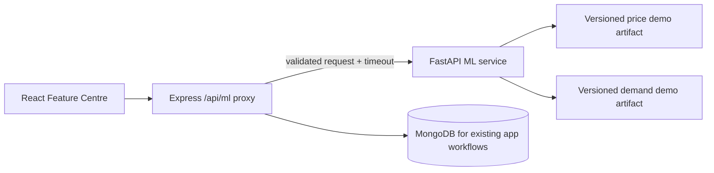

# FarmConnect ML Implementation Report

## Scope and honest feature classification

The existing React + Vite frontend, Express backend, Mongoose models, authentication, marketplace, commerce, and feature centre were preserved. A Python FastAPI service now loads versioned scikit-learn regression artifacts and is reachable only through Express proxy endpoints. The service includes two trained **synthetic-data demonstrations**, not production-valid agricultural models.

| Feature | Actual method in this project | Boundary |
|---|---|---|
| Fair price | Existing server utility uses only configured, dated, sourced reference prices; separate trained regression demo added | ML demo uses synthetic data only and is explicitly not a market quote |
| Farmer–buyer matching | Explainable deterministic rule-based ranking | Not a trained learning-to-rank model |
| Demand forecasting | Existing run-rate based on delivered orders; separate trained regression demo added | Existing run-rate is not a validated seasonal model; demo uses synthetic data only |
| Trust layer | Rule-based display of recorded profile, review, and order evidence | No identity/certification verification or trained fraud detector claimed |
| QR traceability | Database traceability token and public verification route | QR image uses external rendering service; no blockchain/tamper-proof claim |
| Group logistics | Participant/order coordination with workflow validation | No route optimizer, distance estimate, or carrier booking claim |

## New files
- `ml-service/app/main.py`, `schemas.py`: typed FastAPI inference and status endpoints.
- `ml-service/training/train_models.py`: fixed-seed generation, baseline/model comparison, holdout metrics, model serialization.
- `ml-service/data/synthetic/*.csv`: generated demonstration training records.
- `ml-service/models/*.joblib`: fitted model artifacts and metadata.
- `ml-service/tests/`: service and input validation tests.
- `ml-service/model_card.md`, `dataset_sources.md`, `README.md`: provenance, limitations, setup, and evaluation.
- `server/routes/mlRoutes.js`: timeout-aware Express proxy with validation and explicit unavailable errors.

## Training run (synthetic-only)
Training ran in the packaging environment using scikit-learn 1.8.0. The scripts compared DummyRegressor, RandomForestRegressor, and HistGradientBoostingRegressor on the final 20% of generated rows. Selected diagnostics:

| Demo model | Selected algorithm | MAE | RMSE | R² | Baseline MAE |
|---|---|---:|---:|---:|---:|
| Price | HistGradientBoostingRegressor | 3.6436 synthetic INR/kg units | 6.5697 | 0.9922 | 47.0534 |
| Demand | HistGradientBoostingRegressor | 100.2202 synthetic kg | 129.2741 | 0.9890 | 1052.2594 |

These metrics describe fit to a generated formula and noise. They do not indicate performance on actual market prices or FarmConnect orders. No real agricultural dataset was downloaded or represented as available.

## API path
React Feature Centre → Express `/api/ml/demo/*` (authenticated, validates fields, applies timeout) → FastAPI `/demo/*` → loaded joblib model. The FastAPI port is not called by the browser. A service failure returns `model_unavailable`; no fallback value is generated.

## Remaining work before real-market deployment
Obtain and document a legitimate dated market dataset and actual completed-order history; implement date-aware evaluation against those observations; check leakage, drift, sparse categories and calibration; compare against baselines; and only enable production recommendations if performance and coverage are adequate. MongoDB, external services, browser end-to-end, and local Windows setup were not available for full integration verification in this environment.

## Architecture

Both synthetic demonstration models were retrained with a stable 30-product catalogue feature (product ID) plus category and seasonal/input features. Price and demand endpoints were exercised for all 30 catalogue products in the local test client. This improves product-specific behavior only within the generated demonstration dataset; it does not make outputs valid market evidence. The price form now runs the sourced-reference check and synthetic model estimate from one “Get price recommendation” action instead of requiring two separate buttons.

The synthetic ML demonstration does not access MongoDB directly. Existing application records remain under the Express/Mongoose layer.
